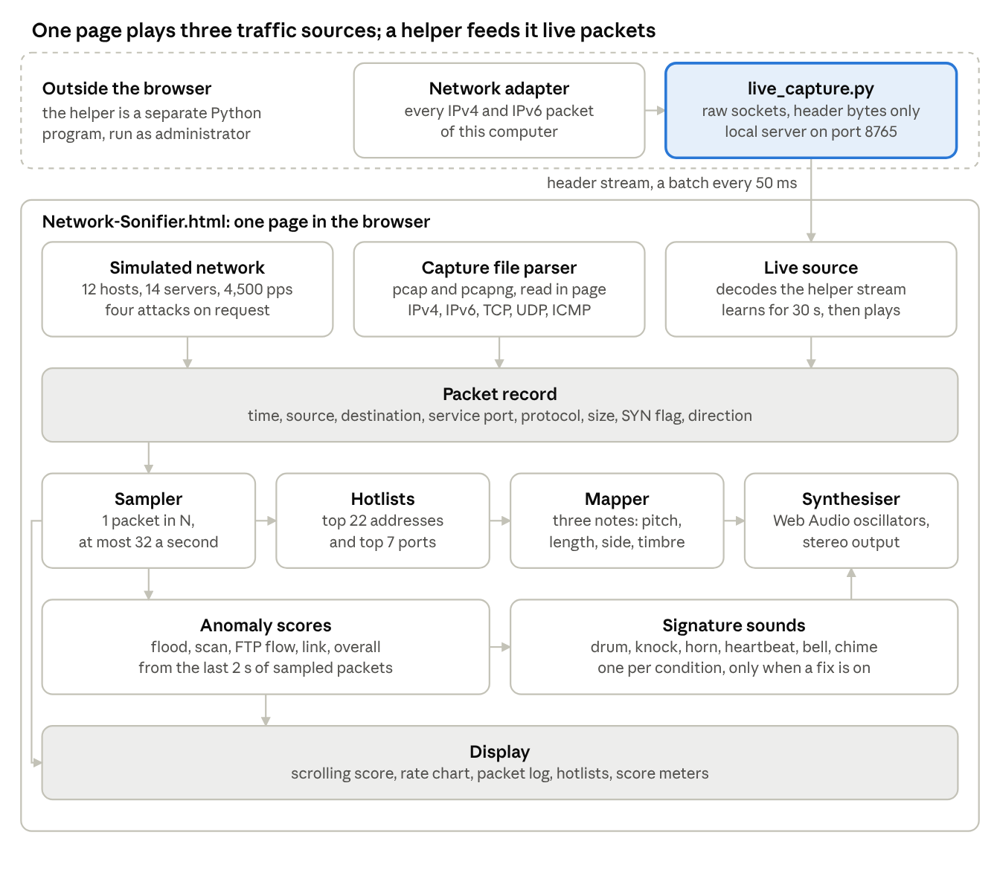

# Network Sonifier: Technical Specification

Oct 12, 2026 · Royce

## Overview

The Network Sonifier plays packet headers as music so that network attacks can be heard. It is a working model of the system evaluated in [Axon, Happa, Goldsmith and Creese, "Hearing attacks in network data: An effectiveness study", Computers & Security, 2019](https://doi.org/10.1016/j.cose.2019.03.004), referred to below as the paper.

The build has two programs. The working model is one web page that produces or reads packets, maps each sampled header to three notes, and plays and displays them. The live traffic capture is a small helper that reads this computer's packets and streams their headers to that page.

| Part | File | What it does | Built with |
| --- | --- | --- | --- |
| Working model | `Network-Sonifier.html`, about 1,200 lines | Simulates a network, reads Wireshark captures, receives live packets, maps headers to sound, plays and displays them | HTML, CSS and JavaScript in one file; Web Audio API; Canvas |
| Live traffic capture | `live_capture.py`, about 140 lines | Reads packet headers from the network adapter and streams them to the page | Python 3 standard library; raw sockets; server-sent events |
| Test capture | `sample-capture.pcapng`, 36,654 packets | A synthetic capture with a flood, a scan, an FTP transfer and an outage | pcapng file |

The source is at [github.com/RoyceRRNS/Network\_Sonifier](https://github.com/RoyceRRNS/Network_Sonifier). Measured behaviour is in `Project-Report.pdf` in the same repository.

## How the build maps to the paper

Every element of the paper's system has a counterpart in the page. The paper's offline pipeline (Python parser, Open Sound Control, SuperCollider, recorded audio) is replaced by code that runs in the browser in real time.

| Paper element | In the paper | In this build | Code |
| --- | --- | --- | --- |
| Approach (Section 3.1) | Parameter-mapping sonification: one note event per sampled packet | Same: one chord of three notes per sampled packet | `play()`, `noteFor()` |
| Packet rate to tempo (Table 1) | Linear sampling with a maximum event rate | Uniform 1 in N sampling, at most 32 packets per second | `tick()`, `capStep()` |
| Packet size to note duration | Larger packet, longer note, at most 1 s | 0.07 s at 40 bytes to 0.57 s at 1,500 bytes | `durFor()` |
| Direction to pan | Incoming left, outgoing right | Pan -0.75 for incoming, +0.75 for outgoing | `play()` |
| Field to pitch range | Source address low, destination address medium, destination port high | C2 to B3, C4 to C5, C6 to C7 | `REG`, `noteFor()` |
| Hotlist to consonance | Hotlists from the first section of the dataset; common values consonant, others a random dissonant frequency | Top 22 addresses and 7 ports of a 30 s baseline; C major pentatonic, or C♯, F♯ or B chosen by a hash of the value | `learnBaseline()`, `buildHotlist()` |
| Protocol to instrument | HTTP strings, TCP clarinet, FTP piano, other strings | Same four, synthesised from oscillators | `INST`, `voice()` |
| Sound engine (Section 3.3) | Python sends Open Sound Control messages to SuperCollider; output recorded to WAV | Web Audio API inside the page, no recording step | `initAudio()`, `voice()` |
| Dataset (Section 3.2) | Synthetic CSV: 25 hosts, 40 remote hosts, 4,500 packets per second, on/off services | Synthetic, generated in memory: 12 hosts, 14 servers, 4,500 packets per second, steady mix | `normalPacket()` |
| Attacks (Section 3.2) | SYN flood (10 bots, 2 packets per second each), TCP connect scan (2 scanners, 15 each), FTP exfiltration (3 per second), connectivity loss | The same four at larger rates, plus one combined attack | `attackPacket()`, `ATTACK_RATE` |
| Playing a dataset | CSV read in pseudo real time | pcap and pcapng files read in pseudo real time | `parseCapture()`, `capStep()` |
| Live traffic (Section 3.3.1, Figure 6) | Proposed, not implemented: capture a packet, parse it, send it to the engine | Implemented: helper captures, page decodes and plays | `live_capture.py`, `liveStep()` |
| Design weaknesses (Sections 7.3, 7.4 and 8) | Scan mistaken for DDoS; FTP piano false positives; connectivity loss heard as silence; fatigue not assessed | Five switchable fixes, off by default | `watch()`, `improve()` |
| Listener study (Sections 5 and 6) | 30 participants; F-score 0.92 after training | Not reproduced; behaviour measured by instrumenting the audio | Project report |

## Architecture

The system is two programs: the page does all the sonification, and the helper only supplies live packets. Inside the page every traffic source produces the same packet record, so one engine serves all three.

Read it from the top. The sampler, hotlists, mapper and synthesiser reproduce the paper's design. The anomaly scores and signature sounds are this build's additions and run only when a fix is switched on.

### The packet record

| Field | Content | Drives |
| --- | --- | --- |
| `t` | Time in seconds | When the notes play |
| `src`, `dst` | Source and destination address, IPv4 or IPv6 | Low and middle note; hotlist lookup |
| `port` | Service port: the lower of the two port numbers, 0 when there is none | High note |
| `proto` | HTTP, FTP, TCP, UDP, ICMP or IP | Instrument |
| `size` | Packet length in bytes | Note length |
| `flags` | `SYN` for a connection request | Flood score |
| `dir` | `in` or `out` | Stereo side |

## Traffic sources: simulated network and capture files

The page has three traffic sources, and each one produces the same packet record. This section covers the two that need no helper; the live source has its own sections below.

### Simulated network

`normalPacket()` builds one background packet and `attackPacket()` builds one attack packet. Nothing is stored: packets are generated only at the moment they are sampled.

| Property | Value |
| --- | --- |
| Hosts | 12 internal (`10.0.1.x`) and 14 external servers, each chosen with Zipf weights (exponents 0.9 and 1.15) |
| Base rate | 4,500 packets per second, varying by about 5% on slow sine waves: `baseRate(t)` |
| Service ports | 443 (46%), 80 (22%), 22 (8%), 21 (7%), 993 (6%), 20 (6%), 25 (5%) |
| Direction | 56% incoming; 85% incoming on the FTP data port |
| Packet size | HTTP in: 1,500 bytes for 60% of packets, otherwise 200 to 1,300. HTTP out: 60 to 440. FTP data: 700 to 1,500. Others: 70 to 550 |
| Rare hosts | 1% of packets use a random external address seen only once (adjustable from 0 to 5%) |

An attack adds packets on top of the background. Its level ramps up over 1.2 s and down over 0.8 s; the connectivity loss fades over 3.2 s and recovers over 2 s.

| Condition | Added rate | Packet |
| --- | --- | --- |
| DDoS SYN flood | +9,000 per second | SYN, 40 to 60 bytes, random source to `10.0.1.10` port 80, incoming |
| Port scan | +2,600 per second | SYN, 44 bytes, one external source to `10.0.1.12`, ports 1 to 1,024 rising |
| Data exfiltration | +1,600 per second | FTP data, 1,380 to 1,500 bytes, `10.0.1.23` to `203.0.113.66`, outgoing |
| Connectivity loss | to zero | Every packet is thinned out by the loss level |
| Combined attack | +10,600 per second | The flood and the exfiltration together |
| Traffic shift | none | Three busy servers move to new addresses; harmless, used to test the hotlists |

The paper's dataset is richer (on/off services, 25 hosts, 40 remote hosts) and its attacks are far smaller, because the paper samples unusual packets with a higher probability. This build samples uniformly, so the attack rates are raised until an attack is a clear share of the sampled packets.

### Wireshark capture files

`parseCapture()` reads a pcap or pcapng file in the browser with a `DataView`. The file never leaves the computer.

| Layer | Supported |
| --- | --- |
| File | pcap (microsecond and nanosecond, both byte orders); pcapng (section, interface and enhanced packet blocks, with the interface's timestamp resolution) |
| Link | Ethernet with VLAN tags, raw IP, loopback, Linux cooked v1 and v2 |
| Network | IPv4 (later fragments carry no ports) and IPv6 with hop-by-hop, routing, fragment and destination headers |
| Transport | TCP, UDP, ICMP and ICMPv6; anything else is labelled IP |

`decodeFrame()` turns one frame into a packet record using three rules.

- **Service port:** the lower of the two port numbers, so a reply sounds like the request it answers.
- **Protocol:** a TCP segment carrying data on port 80 or 443 is HTTP and on port 20 or 21 is FTP, as in Wireshark's protocol column. A bare TCP segment is TCP.
- **Direction:** a private-range source with a public destination is outgoing. When both ends are on the same side, the busiest address is taken to be the capturing host.

`openCapture()` treats the first 30 s (the first third of a shorter file) as the baseline, builds the hotlists from it and sets the sampling ratio to the baseline rate divided by 7.5. `capStep()` then plays the file at its recorded pace, and `seekCapture()` moves the playback position.

## Sonification engine

The engine is the part that reproduces Table 1 of the paper: it samples packets, looks each value up in a hotlist, and plays three notes per packet. It behaves the same for all three traffic sources.

### Hotlists

`learnBaseline()` counts how often each address and each port appears in the baseline. `buildHotlist()` keeps the 22 most frequent addresses and the 7 most frequent ports, and records each one's rank. For simulated traffic the baseline is 135,000 generated packets, which is 30 s at 4,500 packets per second.

This matches the paper, where hotlists are "calculated based on the first section of the dataset". The list size is adjustable from 6 to 26 addresses.

### Sampling and scheduling

`tick()` runs every 25 ms and schedules notes up to 100 ms ahead, in 5 ms slots. Scheduling ahead on the audio clock keeps the rhythm steady even when the screen is busy.

- The note rate is the packet rate divided by the sampling ratio N, capped at 32 packets per second. The default N is 600, which gives 7.5 packets per second.
- In each slot a packet is played with probability rate × slot length. Whether it is a normal or an attack packet is drawn in proportion to their rates.
- `play()` attaches the three notes, the length, the pan and the instrument, then calls `voice()` once per note.

### From header to note

| Header field | Sound | Rule |
| --- | --- | --- |
| Source address | Low note, C2 to B3 | In the hotlist: one of 10 pentatonic notes, chosen by rank. Otherwise C♯, F♯ or B, chosen by a hash of the address |
| Destination address | Middle note, C4 to C5 | In the hotlist: one of 6 pentatonic notes by rank. Otherwise C♯4, F♯4 or B4 by hash |
| Service port | High note, C6 to C7 | In the hotlist: one of 6 pentatonic notes by rank. Otherwise C♯6, F♯6 or B6 by hash |
| Size | Note length | `0.07 + 0.5 × ((size - 40) / 1460)^0.8` seconds |
| Direction | Stereo side | Incoming at -0.75 (left), outgoing at +0.75 (right) |
| Protocol | Instrument | HTTP strings, TCP clarinet, FTP piano, anything else strings |

The consonant notes are the C major pentatonic scale (C, D, E, G, A). The three dissonant notes form a minor second, a tritone and a major seventh against C. The hash is deterministic, so one unusual value always plays the same note; the paper uses a random dissonant frequency instead.

### Synthesiser

`voice()` builds every note from Web Audio oscillators. No audio files are used.

| Voice | Waveform | Filter and envelope |
| --- | --- | --- |
| Strings | Two sawtooth waves, detuned 7 cents up and down | Low-pass at 4.5 times the pitch; 45 ms attack, 180 ms release |
| Clarinet | One square wave | Resonant low-pass at 3.2 times the pitch; 18 ms attack, 60 ms release |
| Piano | Triangle wave plus sine partials at 2 and 3 times the pitch | 5 ms attack, then an exponential decay |
| Drone | C2, G2 and C3 through a 420 Hz low-pass | Constant; fades as traffic stops |

All voices pass through a master gain (the volume slider) and a compressor before the output. The drone is an addition: it gives dissonant notes a root to clash with and, like the paper's sound, falls silent when traffic stops.

## Resolved-flaws module

This module adds five optional fixes for weaknesses of the paper's design. All five are off by default, and with all five off the page plays the paper's design unchanged.

The paper has no detector: the listener is the detector. The fixes need to know when to act, so the module scores the traffic itself and plays a distinct signature sound for each condition.

### Anomaly scores

`watch()` sees every sampled packet and keeps the last 2 s of them. `improve()` runs on every scheduler tick and turns that window into five scores between 0 and 1.

| Score | Formula | Rises when |
| --- | --- | --- |
| Flood | `(S - 5) / 7`, S = different unusual sources sending an incoming SYN | Many new sources open connections at once |
| Scan | `(U - 1) / 5`, U = different unusual ports | Many unusual ports are touched at once |
| FTP flow | `(n - 2) / 4`, n = busiest flow's counter; the counter adds 1 per packet, decays over 3 s and is capped at 8 | One source keeps sending FTP packets to one destination |
| Link | Simulated and file: packet rate of the last second divided by the baseline rate. Live: `2 - 2g / q`, g = seconds since the last packet, q = twice the longest baseline silence, at least 2 s | Falls when traffic stops |
| Overall | The largest of flood, scan, FTP flow, `(0.6 - link) / 0.35` and `(s - s0 - 0.2) / 0.2` | Any of the above, or the share s of unusual packets rising 20 points above its baseline level s0 |

Each formula is clamped to the range 0 to 1. The unusual-share term is left out for live traffic, because one computer's traffic keeps moving to addresses its baseline never saw.

### The five fixes

| Weakness in the paper | Fix | Rule | Signature sound |
| --- | --- | --- | --- |
| Section 7.3 and Table 11: six port scans were named as DDoS, because both produce low dissonant notes | Separate timbres | Drum while the flood score is above 0.3, at 3 to 5 hits per second. Each unusual port not heard in the last 2 s plays a knock in place of its high note | Drum: a triangle wave falling from 190 to 60 Hz. Knock: 820 Hz, 70 ms |
| Section 7.3: piano notes of small, harmless FTP transfers caused false-positive clicks | Level follows flow density | An FTP note plays at 30% level for a lone packet and up to 170% for a dense flow. Horn every 1.1 s while the FTP score is above 0.25 | Car horn: 400 and 500 Hz sawtooth, 0.36 s, on the right |
| Section 7.4 and Table 9: connectivity loss was the slowest to detect, at 6.44 s, and listeners took the silence for the end of the test | Heartbeat carrier tone | A heartbeat every second while the link score is 0.3 or more. Below 0.3 it stops and a tone sounds until traffic returns | Heartbeat: two low thumps. Flatline: 880 Hz |
| Section 3.1: hotlists are fixed after the first section of the dataset (our observation) | Moving-average hotlists | Each value has a weight that adds 1 per sampled packet and decays over 45 s. A new value joins after 30 s of steady presence with no gap over 10 s | Rising three-note chime when an address the baseline never saw is learned |
| Section 8: listener fatigue was left to future work | Adaptive filtering | Notes pass through a 1.1 kHz low-pass at half level. When the overall score passes 0.4 a bell rings, the filter opens to 16 kHz and the level rises by 25% | Bell: 784 Hz, 1.5 s |

### Details that matter

- **Hysteresis:** the filter closes only after the overall score has stayed at or below 0.25 for 1.5 s, so one event rings one bell.
- **Hotlist stability:** members keep a 25% margin over newcomers, and a value that stays in the list keeps its note. A value whose weight falls below 0.05 is forgotten.
- **Known cost:** the moving average also learns an attack that persists for more than 30 s.
- **Kind of sonification:** the signatures are event-based sounds layered on the paper's parameter mapping. The mapped notes keep playing underneath.

## Live traffic capture: live\_capture.py

A web page cannot read network packets, so `live_capture.py` reads them and hands the headers to the page. It builds the path that Figure 6 of the paper proposes but does not implement: capture a packet, parse it, pass it to the sound engine as it arrives.

It uses only the Python standard library. No Wireshark or Npcap is needed, because packets are read with a raw socket.

### Start-up

1. `running()` checks whether port 8765 already answers. If it does, the script only opens the page.
2. If the script has administrator rights, it calls `serve()`.
3. Otherwise it restarts itself elevated through the Windows prompt, waits up to 10 s for the port, and opens the page from the unelevated process. The browser therefore never runs as administrator.

Windows allows raw-socket capture only to an administrator, which is why step 3 exists.

### Capture loop

`serve()` starts one `sniff()` thread for IPv4 and one for IPv6. Each thread repeats these steps.

1. `route_address()` finds this computer's address on the network that carries the default route. It connects a UDP socket to a documentation address, which looks up the route without sending a packet.
2. It opens a raw socket, binds it to that address and switches it to receive-all mode (`SIO_RCVALL`).
3. For each packet it checks that the data starts with an IP header of the right version, then calls `publish()`.
4. After one silent second it checks the route again. If the network has changed, it closes the socket and starts over. A socket error does the same after a 1 s pause.

A packet is marked outgoing when its source address is one of this computer's own addresses, and incoming otherwise.

### What is sent to the page

`publish()` queues one record per packet.

| Field | Content |
| --- | --- |
| Time | Capture time in seconds, to 0.1 ms |
| Direction | 1 for outgoing, 0 for incoming |
| Length | Size of the IP packet in bytes |
| Header bytes | Base64 of the IP header plus the first 20 bytes after it (IPv6: the first 60 bytes). The payload is not sent |

### Local server

| Route | Response |
| --- | --- |
| `/` | The page, read from `Network-Sonifier.html` in the same folder |
| `/live` | A server-sent event stream: one JSON batch of records every 50 ms, empty when nothing arrived |
| Anything else | 404 |

The empty batches let the page tell a quiet network from a stopped helper. Each open page has its own queue of 50,000 records; a page that falls behind loses the oldest.

### Security and privacy

| Concern | Measure |
| --- | --- |
| Who can connect | The server listens on `127.0.0.1` only, so other computers cannot reach it |
| Other websites reading the stream | No cross-origin header is sent, and requests whose Host header is not `127.0.0.1:8765` or `localhost:8765` get 403 |
| What is read | Header bytes only: addresses, ports, flags and sizes |
| What is kept | Nothing is written to disk and nothing is sent to another machine |
| Privilege | Only the capture process is elevated; the browser is not |

## Live source in the page

The page treats live traffic as a capture file that keeps growing, so the playback, hotlist and mapping code is shared with file captures. Only the arrival of packets, the learning period and the outage rule are specific to live traffic.

### Receiving packets

- `openLive()` connects an `EventSource` to `/live`. The helper opens the page at an address ending in `#live`, which starts this automatically.
- `liveStep()` runs for every batch, 20 times a second. It decodes each record's header bytes with `decodeFrame()`, the same decoder used for capture files, in raw-IP mode.
- The direction comes from the helper, which knows this computer's addresses. The file-capture guess from address ranges is not used.

### Clock alignment

The helper stamps packets with its own clock, and the page schedules sound on another. `liveStep()` measures the offset between them on the first packet and plays everything 0.3 s behind capture, which leaves room to schedule notes ahead. If the two clocks ever drift 2 s apart, as after the computer sleeps, the offset is measured again.

### Learning period

| Phase | Length | What happens |
| --- | --- | --- |
| Learning | First 30 s | Packets are counted and charted but nothing plays. The status reads "Live, learning" with a countdown |
| Live | From 30 s | `liveLearned()` builds the hotlists from the learning packets, sets the sampling ratio to their rate divided by 7.5, and playback begins |
| Feed lost | While the helper is unreachable | Playback and scoring pause, so a stopped helper is not reported as an outage. The browser reconnects by itself |

The 30 s of learning correspond to the 30 s of normal traffic that the paper plays to listeners before their first test. The Restart button learns again.

### Rules that differ for live traffic

| Rule | Simulated and file | Live | Reason |
| --- | --- | --- | --- |
| Outage | Packet rate against the baseline rate | Silence longer than twice the longest baseline silence, at least 2 s | One computer's rate swings between bursts and near silence |
| Overall score | Includes the share of unusual packets | Leaves it out | A laptop keeps contacting servers its 30 s baseline never saw |
| Attack buttons | Enabled for simulated traffic | Disabled | A live source plays captured packets only |

Packets already played are dropped once 5,000 have built up, so a long session does not grow in memory.

## User interface and display

The page shows what is being played, so a listener can check a sound against the packet that caused it. The paper's listeners sat with their backs to the screen; the display here is for learning and demonstration.

| Area | Shows | Code |
| --- | --- | --- |
| Header | Start listening and Mute, volume | `setSound()` |
| Readouts | Packet rate, tempo with a word such as Andante, packets sampled, and the current state | `frame()`, `updateStatePill()` |
| Score | A scrolling 12 s view with one staff per register: port on top, destination in the middle, source at the bottom. Unusual values are red; each instrument has its own bar style; injected attacks are shaded | `drawRoll()` |
| Rate chart | Packets per second over the last 30 s | `drawRate()` |
| Left and right meters | How much is playing on each side | `frame()` |
| Traffic source | Open a capture, start live traffic, restart, return to simulated, and a position slider for files | `openCapture()`, `openLive()`, `closeCapture()` |
| Inject an attack | One button per condition, each naming the sound to listen for | `setActive()` |
| Model settings | Sampling ratio (1 in 200 to 2,000), hotlist size, share of rare hosts, drone on or off | `cfg` |
| Sampled packets | The last 16 packets played: time, protocol, direction, addresses, port, size and the three note names | `renderLog()` |
| Resolved flaws | One card and switch per fix, with a live meter for each score | `setFix()`, `showFixes()` |
| Hotlist | The current address and port hotlists with the note each one plays | `renderHotlist()` |

Drawing is separate from sound. `frame()` runs on the screen's refresh and only displays packets whose notes are already scheduled, so a slow screen cannot delay the audio.

## Parameter reference

Every constant that shapes the behaviour is listed here with its value and the name it has in the code.

| Group | Parameter | Value | Name in code |
| --- | --- | --- | --- |
| Traffic | Simulated base rate | 4,500 packets per second | `baseRate()` |
| Traffic | Attack rates: flood, scan, exfiltration | 9,000, 2,600 and 1,600 packets per second | `ATTACK_RATE` |
| Traffic | Rare hosts | 1% of packets | `cfg.noise` |
| Engine | Sampling ratio, simulated | 1 in 600 (adjustable, 200 to 2,000) | `cfg.sampling` |
| Engine | Sampling ratio, file and live | Baseline rate divided by 7.5, at least 1 | `openCapture()`, `liveLearned()` |
| Engine | Baseline | 30 s; 135,000 packets when simulated | `BASELINE_PACKETS`, `LIVE_LEARN` |
| Engine | Hotlist size | 22 addresses (adjustable, 6 to 26), 7 ports | `cfg.kIP`, `cfg.kPort` |
| Engine | Scheduler | Every 25 ms, 100 ms ahead, 5 ms slots | `tick()` |
| Engine | Maximum note rate | 32 packets, or 96 notes, per second | `tick()`, `capStep()` |
| Engine | Note length | 0.07 to 0.57 s | `durFor()` |
| Engine | Note level: source, destination, port | 0.11, 0.09, 0.065 | `VEL` |
| Engine | Pan | -0.75 incoming, +0.75 outgoing | `play()` |
| Engine | Score view and rate chart | 12 s and 30 s | `WIN`, `drawRate()` |
| Fixes | Scoring window | Last 2 s of sampled packets | `recent` |
| Fixes | Drum starts | Flood score above 0.3 | `improve()` |
| Fixes | FTP flow counter | Decays over 3 s, capped at 8 | `FLOW_TAU` |
| Fixes | Horn starts | FTP score above 0.25, then every 1.1 s | `improve()` |
| Fixes | Link counted as down | Link score below 0.3 | `improve()` |
| Fixes | Hotlist moving average | 45 s time constant, 30 s probation, 10 s largest gap | `EMA_TAU`, `EMA_PROBATION`, `EMA_GAP` |
| Fixes | Filter opens and closes | Above 0.4; at or below 0.25 for 1.5 s | `improve()` |
| Fixes | Filter settings | Closed: 1.1 kHz at half level. Open: 16 kHz at 125% | `initFixAudio()` |
| Live | Learning period | 30 s | `LIVE_LEARN` |
| Live | Playback delay | 0.3 s behind capture | `LIVE_LAG` |
| Live | Clock re-alignment | When the clocks differ by 2 s | `liveStep()` |
| Live | Outage limit | Twice the longest baseline silence, at least 2 s | `liveLearned()` |
| Live | Helper address | `127.0.0.1`, port 8765 | `PORT` |
| Live | Stream batch | Every 50 ms | `Handler.stream()` |
| Live | Per-page queue | 50,000 records | `Handler.stream()` |
| Live | Header bytes sent | IPv4 header plus 20 bytes; IPv6 first 60 bytes | `publish()` |

## Differences from the paper and known limits

The mapping follows the paper, but the traffic model, the sampling and the sound engine are simpler, and the build adds things the paper does not have. The table lists each difference and what it changes.

| Aspect | Paper | This build | Consequence |
| --- | --- | --- | --- |
| Sampling | Unusual packets are sampled with a higher probability | Uniform 1 in N | An attack must be a larger share of traffic to be heard, so attack rates are raised |
| Background traffic | Each service switches on and off; 25 hosts, 40 remote hosts | Steady mix; 12 hosts, 14 servers | Normal sound varies less |
| Dissonant notes | A random dissonant frequency | One of three fixed notes, by hash | The same unusual value always sounds the same |
| Longest note | 1 s | 0.57 s | Dense traffic overlaps less |
| Instruments | SuperCollider | Basic waveforms | Timbres are less distinct |
| Internal traffic | Not sonified | Played when it appears in a file or live | A local file copy is audible |
| Background drone | Not described | Added, fades when traffic stops | Dissonance is easier to hear |
| Timing | Audio recorded in advance | Real time | Works on live traffic |
| Detection | By the listener only | Listener, plus optional scores and signatures | Signatures share the blind spots of the scores |
| Evaluation | 30 listeners | Instrumented counts of sounds | Listener performance is unknown |

Known limits of the build:

- The helper runs on Windows only, needs administrator rights and captures one computer, not a network link.
- IPv6 capture has been tested with synthetic packets only; the test network had no IPv6.
- A UDP flood does not raise the flood score, and an attack shaped like normal traffic raises none.
- Thresholds were set by hand and checked on runs of 40 to 150 s.
- One bell rings 0.3 s after a capture file starts, because the rate window is still empty.
- The fixes have not been tested with listeners.

## Files and how to run

The working model needs only a browser. The live capture also needs Python 3 on Windows and administrator approval.

| File | Purpose |
| --- | --- |
| `Network-Sonifier.html` | The working model: markup, styles and script in one file |
| `live_capture.py` | The live traffic capture helper |
| `sample-capture.pcapng` | Test capture: flood at 40 s, scan at 62 s, FTP transfer at 80 s, outage at 100 s |
| `Project-Report.pdf` | Project report with the measured results |
| `rkp78gg67f.pdf`, `NOTICE.md` | The paper's accepted manuscript and its licence notice |

| To hear | Steps |
| --- | --- |
| Simulated traffic | Open `Network-Sonifier.html` in a browser and press Start listening. Switch attacks on under Inject an attack and fixes on under Resolved flaws |
| A capture file | Press Open Wireshark capture and choose a pcap or pcapng file |
| Live traffic | Run `python live_capture.py` in the same folder and accept the administrator prompt. The page opens, learns for 30 s, then plays. Close the helper's window to stop |

The helper finds the page by file name, so both files must stay in the same folder with their names unchanged.
